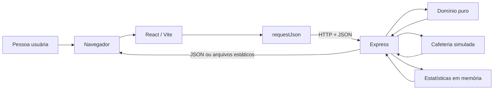
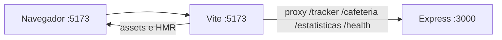
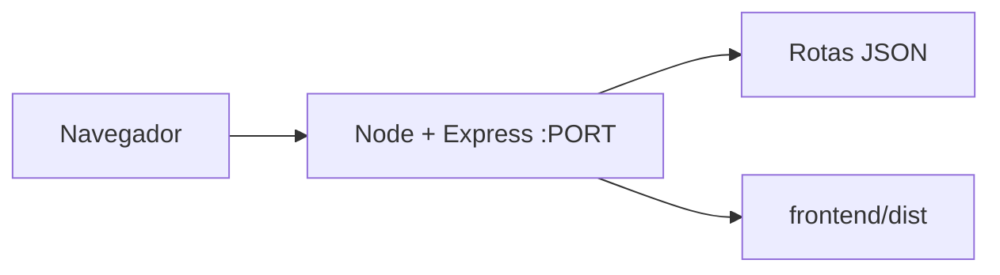
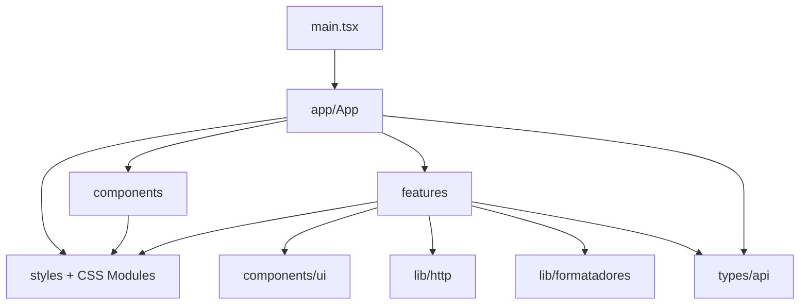
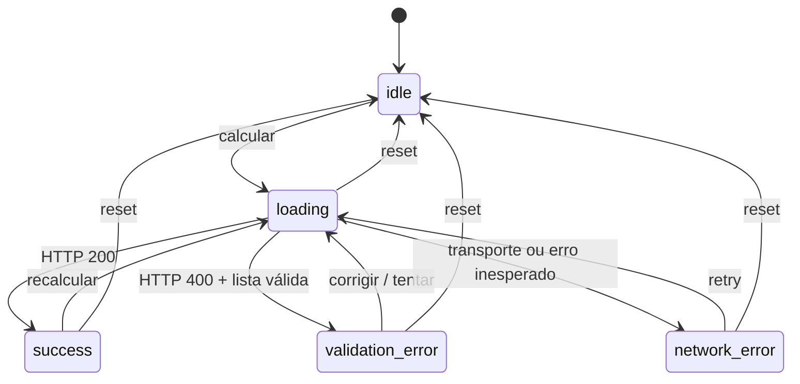
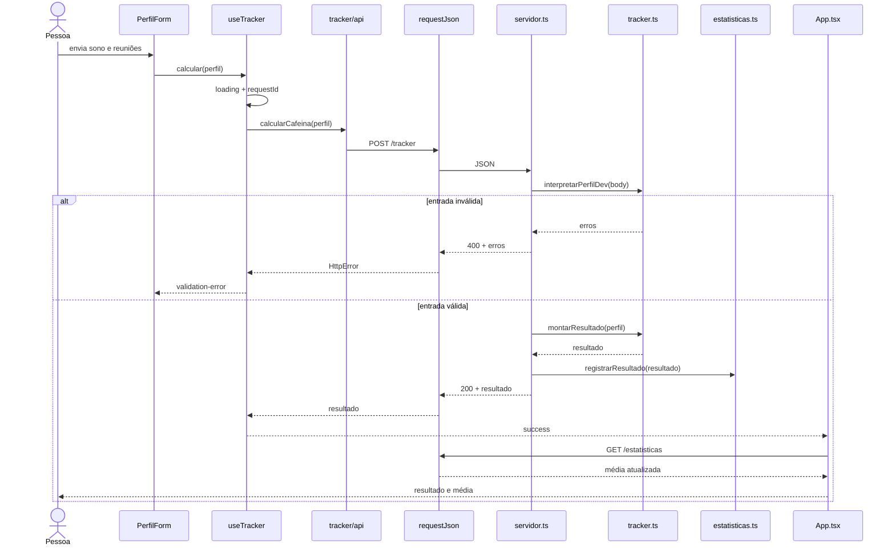

# Arquitetura do Cafeína Tracker

Este documento é a referência técnica do repositório completo. Ele descreve o
estado implementado, as interfaces entre módulos, os fluxos de execução, os
testes, as configurações e as limitações atuais. Funcionalidades presentes
somente em `.spec/` são identificadas como planejamento.

## 1. Resumo executivo

O Cafeína Tracker é um projeto didático full stack organizado em dois pacotes
npm:

- a raiz contém uma API Express, regras de negócio TypeScript, serviços
  simulados, testes Jest/Jasmine e a orquestração do repositório;
- `frontend/` contém uma SPA React compilada pelo Vite, com dependências,
  configuração TypeScript e lockfile próprios.

O domínio recebe horas de sono e quantidade de reuniões, recomenda uma
quantidade de cafés, classifica o risco e escolhe um motivo bem-humorado. A API
também simula uma cafeteria e mantém a média das recomendações enquanto o
processo estiver ativo.

Em desenvolvimento, Vite e Express são processos separados. No build local, o
Express entrega tanto os endpoints JSON quanto os arquivos de
`frontend/dist/`, formando um único processo de execução.



## 2. Objetivos e limites arquiteturais

### Objetivos atendidos

- manter a lógica de negócio independente de Express, React e runners de teste;
- executar a mesma matriz essencial de regras em Jest e Jasmine;
- demonstrar teste unitário, assincronismo, snapshot, integração HTTP e
  paridade entre runners;
- oferecer uma interface acessível para apresentar o sistema em um seminário;
- usar TypeScript estrito e builds explícitos;
- permitir desenvolvimento separado e entrega local em um único processo.

### Limites atuais

- não há autenticação, autorização ou gestão de usuários;
- não há banco, cache persistente ou fila;
- não há integração real com cafeterias;
- o estado estatístico pertence a uma única instância do processo;
- não há rate limiting, logs estruturados ou telemetria;
- não há testes automatizados React nem testes end-to-end de navegador;
- não há configuração de deploy em nuvem;
- o laboratório executável existe apenas como spec em rascunho.

## 3. Vocabulário arquitetural

Este documento usa quatro conceitos para explicar o desenho:

- **módulo**: uma parte com interface e implementação, como `tracker.ts`,
  `requestJson` ou a feature `tracker`;
- **interface**: tudo que um chamador precisa saber, incluindo tipos, estados,
  erros, efeitos e configuração;
- **seam**: o ponto em que uma interface permite variar comportamento sem
  alterar o chamador;
- **adapter**: a implementação concreta conectada a uma seam, como o handler
  Express que adapta HTTP ao domínio ou `requestJson` que adapta uma feature ao
  navegador.

O módulo mais profundo é `src/logica/tracker.ts`: sua interface é formada por
funções e tipos pequenos, mas concentra validação, cálculo, classificação e
composição. Os handlers Express permanecem finos porque adaptam transporte; os
componentes React trabalham com estados de produto, não com `Response` ou
objetos do Express.

## 4. Inventário do repositório

### Árvore comentada

```text
cafeina-tracker-api/
├── .agents/                         metadados locais de agentes
├── .codex/                          metadados locais do ambiente Codex
├── .git/                            metadados locais de versionamento
├── .spec/
│   ├── constituicao.md              regras permanentes de engenharia
│   ├── features/
│   │   ├── cafeina-tracker-api/     spec, design, tarefas e plano da API
│   │   ├── frontend-arquitetura/    spec e plano da estrutura React
│   │   ├── frontend-design/         direção visual, tarefas e QA
│   │   └── laboratorio-executavel/  proposta futura ainda não implementada
│   └── verification/                relatórios JSON e sinais de rastreabilidade
├── build/                           saída compilada da API e do Jasmine
├── coverage/                        cobertura Jest gerada da API
├── docs/
│   ├── README.md                    índice geral da documentação
│   ├── arquitetura.md               este documento
│   ├── auditoria-arquitetura.md     achados e decisões da auditoria
│   ├── frontend-design.md           guia da interface do seminário
│   ├── qa/frontend-design/          relatório e capturas de QA visual
│   └── testes/                      guias de Jest, Jasmine e organização
├── frontend/
│   ├── dist/                        bundle de produção gerado pelo Vite
│   ├── node_modules/                dependências instaladas do pacote
│   ├── public/
│   │   └── favicon.svg              asset público copiado pelo Vite
│   ├── src/
│   │   ├── app/                     composição global da SPA
│   │   ├── assets/                  reservado a assets importados; vazio hoje
│   │   ├── components/
│   │   │   └── ui/                  elementos visuais reutilizáveis
│   │   ├── features/
│   │   │   ├── cafeteria/           consulta assíncrona e sua interface
│   │   │   ├── estatisticas/        média da sessão e sua interface
│   │   │   ├── laboratorio/         guia didático Jest versus Jasmine
│   │   │   ├── status/              saúde da API
│   │   │   └── tracker/             cálculo, estado e visualização principal
│   │   │       └── components/       formulário, resultado, xícara e risco
│   │   ├── lib/                     HTTP, formatação e classes CSS
│   │   ├── styles/                  tokens, reset, globals e motion
│   │   ├── test/                    setup e mocks técnicos do Jest
│   │   └── types/                   contratos HTTP do navegador
│   ├── eslint.config.js             lint de TS, React hooks e acessibilidade
│   ├── jest.config.cjs              Jest/jsdom transformado por SWC
│   ├── package.json                 manifesto do frontend
│   ├── package-lock.json            lockfile independente do frontend
│   ├── tsconfig*.json               projetos TypeScript da SPA e do Vite
│   └── vite.config.ts               build, servidor e proxy de desenvolvimento
├── node_modules/                    dependências instaladas da raiz
├── scripts/
│   └── run-spec-tests.mjs           agrega execução e relatórios das suítes
├── src/
│   ├── logica/
│   │   ├── tipos.ts                 contratos internos do domínio
│   │   └── tracker.ts               validação, cálculo, risco e composição
│   ├── servico/
│   │   ├── cafeteria.ts             Promise, atraso e valores simulados
│   │   └── estatisticas.ts          estado e média em memória
│   ├── index.ts                     entrada e abertura da porta
│   └── servidor.ts                  criação do app, rotas e arquivos estáticos
├── tests-jasmine/
│   ├── support/jasmine.json         descoberta em build/tests-jasmine
│   ├── cafeteria.spec.ts
│   ├── estatisticas.spec.ts
│   └── tracker.spec.ts
├── tests-jest/
│   ├── __snapshots__/               snapshot do resultado do tracker
│   ├── cafeteria.test.ts
│   ├── estatisticas.test.ts
│   ├── paridade.test.ts
│   ├── servidor.test.ts
│   ├── tracker.test.ts
│   └── tsconfig.json                associação automática do editor ao Jest
├── .gitignore                       ignora dependências, build e cobertura
├── jest.config.js                   Jest da API
├── onpspec.config.json              descoberta de fontes/testes pelas specs
├── package.json                     manifesto e orquestração da raiz
├── package-lock.json                lockfile da raiz
├── README.md                        instalação e uso rápido
├── spec.md                          especificação técnica inicial
├── tsconfig.jest.json               tipos Jest sem emissão
└── tsconfig.json                    build da API e dos specs Jasmine
```

### Código-fonte versus artefatos

| Categoria | Caminhos | Regra |
|---|---|---|
| Fonte da API | `src/`, `tests-jest/`, `tests-jasmine/` | Editar e versionar |
| Fonte da SPA | `frontend/src/`, `frontend/public/` | Editar e versionar |
| Configuração | `package*.json`, `tsconfig*.json`, configs Jest/Vite/ESLint | Editar com revisão |
| Documentação | `README.md`, `docs/`, `spec.md`, `.spec/features/` | Editar e manter coerente |
| Saída compilada | `build/`, `frontend/dist/` | Gerar; não editar manualmente |
| Cobertura | `coverage/`, `frontend/coverage/` quando criada | Gerar; não editar |
| Dependências | `node_modules/`, `frontend/node_modules/` | Gerar com npm; não versionar |
| Verificação | `.spec/verification/` | Gerada ou atualizada pelo fluxo de spec |

## 5. Pacotes e dependências

### Pacote da raiz

O manifesto `package.json` possui três responsabilidades:

1. dependências de runtime da API (`express`);
2. ferramentas de build e teste (`typescript`, `tsx`, Jest, Jasmine,
   Supertest e tipos);
3. orquestração do frontend por comandos `npm --prefix frontend`.

Seu lockfile é `package-lock.json`. O artefato principal é
`build/src/index.js`, executado com Node sem loader TypeScript.

### Pacote `frontend/`

O frontend é privado e usa React, React DOM, Motion, Lucide e fontes locais em
runtime. Vite, TypeScript, ESLint, Jest, SWC e Testing Library são ferramentas
de desenvolvimento. Seu manifesto e lockfile não devem ser misturados com os
da raiz.

### Relação entre os pacotes

Não há workspace npm nem import TypeScript entre eles. A seam é HTTP/JSON:

- o backend define o comportamento real dos endpoints;
- `frontend/src/types/api.ts` espelha os payloads necessários ao navegador;
- o proxy Vite conecta as origens no desenvolvimento;
- `frontend/dist/` conecta os pacotes no build de produção local.

Essa separação evita empacotar código Node no navegador, mas cria risco de
drift de contrato. Toda mudança de payload deve atualizar os dois lados e seus
testes no mesmo trabalho.

## 6. Topologia de execução

### Desenvolvimento



`npm run dev:all` usa `concurrently` para iniciar:

- `npm run dev:api`: `tsx watch src/index.ts`;
- `npm run dev:web`: Vite em `127.0.0.1:5173` com `strictPort`.

Se um processo falhar, `--kill-others-on-fail` encerra o outro. O proxy faz o
navegador trabalhar com uma origem aparente única; o projeto não configura
CORS na API.

### Produção local



`npm run build:all` executa o TypeScript da raiz e o build do frontend:

```text
build/src/**/*.js                  API compilada
build/tests-jasmine/**/*.js        specs Jasmine compilados
frontend/dist/index.html           entrada da SPA
frontend/dist/assets/*             JS, CSS, fontes e assets versionados pelo Vite
```

`npm start` abre somente `build/src/index.js`. `PORT` é aceita quando for um
inteiro positivo; qualquer valor ausente ou inválido usa `3000`.

## 7. Backend

### Mapa de módulos

| Módulo | Interface principal | Implementação e efeitos |
|---|---|---|
| `src/logica/tipos.ts` | `PerfilDev`, `NivelRisco`, `ResultadoTracker`, `StatusCafeteria`, `ErroValidacao` | Tipos TypeScript; nenhum efeito |
| `src/logica/tracker.ts` | Funções de validação, cálculo, classificação, sorteio e composição | Regra pura, exceto leitura de `Math.random()` no sorteio |
| `src/servico/cafeteria.ts` | `buscarStatusCafeteria(id)` | Promise com `setTimeout` e dois sorteios |
| `src/servico/estatisticas.ts` | registrar, calcular média e resetar | Muta um array privado do processo |
| `src/servidor.ts` | `criarServidor(frontendDist?)` e app padrão | Adapta HTTP, chama módulos e serve arquivos |
| `src/index.ts` | processo executável | Resolve a porta, chama `listen` e registra mensagem no console |

### Domínio do tracker

`interpretarPerfilDev(entrada: unknown)` é a interface de entrada segura do
domínio. Ela não confia no corpo HTTP e devolve uma união discriminada:

```ts
{ valido: true, perfil: PerfilDev }
// ou
{ valido: false, erros: ErroValidacao[] }
```

As invariantes são:

- `horasSono` é número finito entre `0` e `24`, incluindo frações;
- `quantidadeReunioes` é número finito, inteiro e não negativo;
- todos os campos inválidos são reportados na mesma resposta;
- entradas não objeto são tratadas como objeto vazio e geram os dois erros.

O cálculo usa:

```text
déficit de sono = max(0, 8 - horasSono)
cafés por reuniões = floor(quantidadeReunioes / 2)
recomendação = min(10, 1 + déficit de sono + cafés por reuniões)
```

Como horas de sono podem ter frações, `cafesRecomendados` também pode ser
fracionário. A classificação usa as seguintes faixas:

| Quantidade | Nível de risco |
|---:|---|
| até 3 | `Seguro` |
| maior que 3 e até 6 | `Atenção` |
| maior que 6 e até 9 | `Risco Alto` |
| maior que 9 | `Chama o Cardiologista` |

`montarResultado` compõe cálculo, classificação e `sortearMotivoExtra`. O
sorteio usa uma lista fixa de cinco motivos e `Math.random`, controlado por spy
nos testes.

### Serviços

`buscarStatusCafeteria` rejeita IDs vazios ou formados somente por espaços.
Para IDs válidos, espera exatamente 200 ms e resolve:

- o mesmo `cafeteriaId` recebido;
- preço entre R$ 3,00 e R$ 12,00, com duas casas decimais;
- disponibilidade booleana calculada por outro sorteio.

O serviço não realiza I/O externo. O atraso e a aleatoriedade simulam uma seam
de integração futura sem introduzir hoje um adapter remoto hipotético.

`estatisticas.ts` guarda apenas `cafesRecomendados` em um array privado. A média
é zero quando o array está vazio e aritmética simples nos demais casos.
`resetarEstatisticas` existe para isolamento dos testes; não há endpoint público
de reset.

### Camada HTTP

`criarServidor(frontendDist?)` constrói uma instância Express importável sem
abrir porta. Essa interface permite ao Supertest testar a aplicação em memória
e permite injetar um diretório estático temporário.

`express.json({ limit: '16kb' })` analisa o corpo antes dos handlers. As rotas
JSON são registradas antes de `express.static`, preservando sua precedência
sobre arquivos com nomes iguais.

| Método e caminho | Entrada | Sucesso | Erro conhecido | Efeito |
|---|---|---|---|---|
| `POST /tracker` | JSON com `horasSono` e `quantidadeReunioes` | `200` + `ResultadoTracker` | `400` + lista de `ErroValidacao` | Registra cafés somente no sucesso |
| `GET /cafeteria/:id` | ID no path | `200` + `StatusCafeteria` após 200 ms | `400` + `{ mensagem }` para ID vazio | Nenhum estado persistido |
| `GET /cafeteria` | Sem ID | — | `400` + `{ mensagem: "cafeteriaId inválido." }` | Nenhum |
| `GET /estatisticas` | Nenhuma | `200` + `{ mediaCafes }` | Não há erro de domínio previsto | Leitura da memória |
| `GET /health` | Nenhuma | `200` + mensagem de saúde | Não há erro de domínio previsto | Nenhum |
| Arquivo estático | Caminho sob `frontend/dist` | Arquivo encontrado | Comportamento padrão do Express se ausente | Leitura do filesystem |

Não há middleware próprio para JSON malformado, payload acima do limite,
404, logs ou erro interno. Nesses casos vale o tratamento padrão do Express.

## 8. Frontend

### Bootstrap e composição

`frontend/src/main.tsx`:

- importa fontes empacotadas e quatro folhas globais;
- valida a existência de `#root`;
- monta `App` em `StrictMode`;
- configura Motion com `reducedMotion="user"`.

`frontend/src/app/App.tsx` é o módulo de composição. Ele coordena quatro estados
independentes: tracker, saúde da API, média da sessão e abertura do laboratório.
Também registra a última chamada bem-sucedida do tracker para exibi-la no guia
didático.

### Grafo de dependências atual



`lib` e `types` não importam React. `components/ui` não conhece endpoints nem
regras de café. As funções `api.ts` conhecem caminhos HTTP e retornam tipos do
produto. Essa direção mantém infraestrutura e apresentação fora do domínio da
API.

Os `index.ts` funcionam como interfaces públicas parciais: expõem APIs, o hook
do tracker e o laboratório. Hoje `App.tsx` ainda importa diretamente alguns
componentes internos de `features/` (`CafeteriaStatus`, `MediaCafes`,
`PerfilForm` e `ResultadoTracker`). Portanto, encapsulamento total por barrels é
uma direção possível, não uma regra já cumprida. Para torná-lo obrigatório,
primeiro seria necessário exportar esses componentes pelos respectivos
`index.ts` e então ajustar os imports.

### Features

| Feature | Interface usada | Estado e responsabilidade |
|---|---|---|
| `tracker/` | `useTracker`, `calcularCafeina` e componentes visuais | Envia perfil, distingue validação/rede, preserva resultado anterior e renderiza formulário, xícara e risco |
| `cafeteria/` | `buscarStatusCafeteria` e `CafeteriaStatus` | Valida ID localmente, consulta, mostra carregamento, sucesso, erro e retry |
| `estatisticas/` | `buscarEstatisticas` e `MediaCafes` | Carrega média inicial, atualiza após cálculo e preserva valor durante retry |
| `status/` | `buscarStatusApi` | Consulta `/health` no início e sob demanda |
| `laboratorio/` | `LaboratorioTestes`, exemplos e tipos guiados | Drawer somente leitura para comparar linhas Jest/Jasmine e mostrar a última chamada real |

### Estado do tracker

`TrackerState` é uma união discriminada:



Durante `loading` ou erro, o resultado anterior pode permanecer visível.
`useTracker` incrementa `requestId`; respostas antigas e respostas posteriores
a um reset não podem sobrescrever o estado mais recente.

As ações manuais de retry da saúde e refresh das estatísticas usam contadores de
requisição. Nos efeitos iniciais, `App` usa uma flag `active` para evitar
atualização depois do unmount; esses carregamentos iniciais não compartilham o
contador dos retries. A feature cafeteria possui seu próprio contador contra
respostas fora de ordem.

### Adapter HTTP do navegador

`frontend/src/lib/http.ts` é o único arquivo que chama `fetch`. Sua interface
`requestJson<T>(caminho, init?)`:

- aceita somente caminhos iniciados por `/` no nível de tipos;
- monta URL com `window.location.origin`;
- envia `Accept: application/json`;
- adiciona `Content-Type: application/json` quando há body;
- só lê o corpo quando o `content-type` informa JSON;
- converte resposta HTTP não OK em `HttpError(status, payload)`;
- converte falha de acesso ao servidor em `NetworkError`.

O genérico `T` não valida o JSON em runtime. Somente o payload de erro 400 do
tracker recebe uma verificação estrutural antes de virar erro de campo. Para
contratos externos ou mais críticos, um schema em runtime seria necessário.

### Componentes e UI compartilhada

`frontend/src/components/` contém `AppHeader` e `ApiStatus`. A subpasta `ui/`
expõe `Button`, `IconButton`, `FieldMessage` e `StatusPill`, todos sem acesso a
rede.

O resultado principal é dividido em:

- `PerfilForm`: entradas controladas, foco no primeiro erro e retry;
- `ResultadoTracker`: escolhe os estados visuais e preserva a última resposta;
- `XicaraMedidor`: representa `cafesRecomendados / 10` visual e textualmente;
- `RiscoGauge`: mapeia as quatro classificações para texto, ícone e tom.

### Estilos, assets e acessibilidade

| Caminho | Responsabilidade |
|---|---|
| `styles/tokens.css` | Cores, tipografia, espaço, bordas, sombras e motion compartilhados |
| `styles/reset.css` | Normalização dos elementos HTML |
| `styles/globals.css` | Estrutura global, utilitários, botões, pills e skip link |
| `styles/motion.css` | Entrada da aplicação e redução de movimento |
| `*.module.css` | Layout e aparência local de App, cabeçalho e features |
| `public/favicon.svg` | Favicon servido na raiz |
| `src/assets/` | Pasta reservada, atualmente vazia |

A interface inclui skip link, regiões `aria-live`, alertas, rótulos, foco no
primeiro erro, alvos de botão, navegação por teclado no laboratório, focus trap,
fechamento com Escape e retorno de foco. Movimento reduzido remove ou simplifica
animações sem retirar conteúdo.

## 9. Fluxos principais

### Calcular uma recomendação



### Consultar uma cafeteria

1. `CafeteriaStatus` remove espaços nas extremidades e bloqueia ID vazio.
2. `features/cafeteria/api.ts` codifica o ID com `encodeURIComponent`.
3. `requestJson` faz `GET /cafeteria/:id`.
4. Express aguarda `buscarStatusCafeteria`.
5. Depois de 200 ms, a interface mostra preço e disponibilidade; falhas viram
   mensagem e botão de retry.

### Verificar saúde e estatísticas

Ao montar, `App` dispara `GET /health` e `GET /estatisticas` de forma
independente. Um cálculo bem-sucedido atualiza a média. Falhar ao atualizar a
média não apaga um valor anterior. Reiniciar a API apaga a memória e faz a média
voltar a zero.

## 10. Arquitetura de testes

### Runners e configuração

| Suíte | Descoberta | Transformação | Ambiente | Escopo atual |
|---|---|---|---|---|
| Jest da API | `tests-jest/**/*.test.ts` | `ts-jest` + `tsconfig.jest.json` | Node | Domínio, serviços, HTTP, snapshot e contratos estruturais |
| Jasmine da API | `build/tests-jasmine/**/*[sS]pec.js` | `tsc` antes do runner | Node | Mesma matriz marcada de domínio e serviços |
| Jest do frontend | `frontend/src/**/*.test.ts(x)` | `@swc/jest` | jsdom | Configurado, mas zero casos hoje |

O `tsconfig.json` da raiz inclui tipos Node/Jasmine, `src` e `tests-jasmine`,
emitindo em `build/`. `tsconfig.jest.json` troca os globais por Node/Jest,
inclui `tests-jest`, habilita `isolatedModules` para o modo Node16 do `ts-jest`
e usa `noEmit`. `tests-jest/tsconfig.json` estende essa configuração com o nome
convencional que o editor descobre dentro da pasta. A separação evita conflito
entre as declarações globais dos runners tanto na CLI quanto no editor.

### Inventário de casos

| Arquivo | Quantidade | O que prova |
|---|---:|---|
| `tests-jest/tracker.test.ts` | 9 | Fórmula, teto, faixas, sorteio, validação e snapshot |
| `tests-jest/cafeteria.test.ts` | 2 | Atraso/aleatoriedade e ID inválido |
| `tests-jest/estatisticas.test.ts` | 3 | Vazio, média e reset |
| `tests-jest/servidor.test.ts` | 6 | Rotas, erros, registro, saúde e precedência dos arquivos estáticos |
| `tests-jest/paridade.test.ts` | 2 | Marcadores equivalentes e execução sobre JavaScript compilado |
| `tests-jasmine/tracker.spec.ts` | 9 | Matriz de tracker equivalente ao Jest |
| `tests-jasmine/cafeteria.spec.ts` | 2 | Serviço assíncrono equivalente ao Jest |
| `tests-jasmine/estatisticas.spec.ts` | 3 | Estado em memória equivalente ao Jest |
| Frontend `*.test.*` | 0 | Ainda não há comportamento React automatizado |

Jest possui 22 casos; Jasmine possui 14. “Paridade” não significa quantidade
total igual: marcadores `@paridade:<caso>` exigem equivalência apenas para a
matriz de domínio e serviços compartilhada. Os seis casos HTTP e os dois testes
de contrato estrutural são responsabilidades adicionais do Jest.

`resetarEstatisticas()` roda no `beforeEach` das suítes que tocam memória.
`Math.random`, temporizadores e o serviço da cafeteria são controlados por spies
ou timers falsos para manter determinismo.

### Relatórios de spec

`scripts/run-spec-tests.mjs` executa, em ordem:

1. Jasmine da API;
2. Jest da API com JSON;
3. Jest do frontend com JSON.

O relatório `.spec/verification/all-results.json` agrega os resultados JSON dos
dois Jest. A execução do Jasmine influencia o campo geral de sucesso pelo exit
code, mas seus casos não entram na contagem agregada porque o runner não gera
um relatório JSON consumido pelo script atual.

## 11. Especificação e rastreabilidade

`onpspec.config.json` declara:

- comando de verificação: `npm run test:spec:all`;
- reporter agregado: `jest-json`;
- padrões de teste backend e frontend;
- padrões de fonte TypeScript, TSX e CSS.

`.spec/constituicao.md` contém regras duradouras. Cada pasta de feature pode
conter:

- `spec.md`: histórias e critérios de aceite;
- `design.md`: decisões e contratos técnicos;
- `tasks.md`: implementação rastreada por critérios;
- `plano-execucao.md`, `.json` e `.html`: planejamento e visualização;
- `executar-tarefas.sh`: automação gerada;
- documentos especializados, como QA ou prompt de design.

Situação funcional:

| Feature especificada | Relação com o código atual |
|---|---|
| `cafeina-tracker-api` | Implementação base presente em `src/` e testes backend |
| `frontend-arquitetura` | Estrutura React/Vite presente em `frontend/` |
| `frontend-design` | Interface e evidências de QA presentes; documentos de tarefas podem preservar status históricos |
| `laboratorio-executavel` | Rascunho futuro; editor, executor, fila e endpoints não existem |

## 12. Configurações importantes

| Arquivo | Decisão relevante |
|---|---|
| `package.json` | Scripts integrados, Node `>=20.19`, Express em runtime |
| `package-lock.json` | Instalação reprodutível da raiz |
| `tsconfig.json` | ES2022, Node16, strict, `noUncheckedIndexedAccess`, emissão em `build/` |
| `tsconfig.jest.json` | Jest sem emissão e sem tipos Jasmine |
| `tests-jest/tsconfig.json` | Associa automaticamente os testes ao projeto Jest no editor |
| `jest.config.js` | Node, ts-jest e cobertura de `src/` exceto bootstrap |
| `onpspec.config.json` | Fontes, testes e saída da verificação por spec |
| `frontend/package.json` | React/Vite e ferramentas da SPA |
| `frontend/package-lock.json` | Instalação reprodutível do frontend |
| `frontend/vite.config.ts` | Porta estrita e proxy das quatro famílias de rotas |
| `frontend/jest.config.cjs` | jsdom, SWC, mocks CSS/assets e `jest-dom` |
| `frontend/eslint.config.js` | TypeScript, hooks, refresh e regras recomendadas de acessibilidade |
| `frontend/tsconfig.app.json` | ES2023/DOM, JSX automático, bundler e verificações sem emissão |
| `frontend/tsconfig.node.json` | Tipagem do `vite.config.ts` em Node |
| `.gitignore` e `frontend/.gitignore` | Exclusão de dependências, builds, cobertura, logs e arquivos locais |

Não há arquivo `.env.example` porque `PORT` é a única variável de ambiente
usada. O frontend usa caminhos relativos e não precisa de URL de API configurada
no desenho atual.

## 13. Comandos e artefatos

| Intenção | Comando | Saída ou efeito |
|---|---|---|
| Instalar API | `npm ci` | `node_modules/` |
| Instalar SPA | `npm --prefix frontend ci` | `frontend/node_modules/` |
| Desenvolver tudo | `npm run dev:all` | Express 3000 + Vite 5173 |
| Desenvolver API | `npm run dev:api` | watch com `tsx` |
| Desenvolver SPA | `npm run dev:web` | Vite |
| Compilar raiz | `npm run build` | `build/` |
| Compilar tudo | `npm run build:all` | `build/` + `frontend/dist/` |
| Executar local | `npm start` | Node sobre JavaScript compilado |
| Testar API com Jest | `npm run test:jest` | 22 casos atuais |
| Cobrir API | `npm run test:jest:coverage` | `coverage/` |
| Checar tipos Jest | `npm run typecheck:jest` | Valida `tests-jest/tsconfig.json` sem emitir arquivos |
| Testar API com Jasmine | `npm run test:jasmine` | build + 14 casos atuais |
| Testar as duas APIs | `npm test` | Jest seguido de Jasmine |
| Testar frontend | `npm run test:frontend` | Jest/jsdom; aceita zero casos |
| Testar tudo | `npm run test:all` | API + frontend |
| Verificar specs | `npm run test:spec:all` | JSON em `.spec/verification/` |
| Verificação completa | `npm run verify:all` | builds, tipos Jest, testes, lint e tipos frontend |
| Auditar dependências | `npm run audit:all` | auditoria npm dos dois pacotes |

## 14. Decisões arquiteturais

### Domínio separado do transporte

O backend HTTP recebe `unknown` e chama o parser do domínio. Express não aparece
em `src/logica/`, permitindo testes rápidos e reaproveitamento por dois runners.

### Aplicação importável sem porta

`servidor.ts` exporta `criarServidor` e um app padrão; somente `index.ts` chama
`listen`. Isso cria uma seam real usada pelo processo e pelo Supertest.

### Dois pacotes sem compartilhamento de código

O navegador não importa os tipos do backend. A duplicação dos DTOs é aceita
para preservar a separação de ambientes, com o custo de sincronização manual.

### Estado em memória deliberado

A média demonstra estado e isolamento de testes sem adicionar banco ao
seminário. A consequência é perda no restart, ausência de compartilhamento
entre réplicas e crescimento do array durante toda a vida do processo.

### Aleatoriedade controlável

Motivo, preço e disponibilidade usam `Math.random`. Em produção local o
resultado varia; nos testes, spies tornam os cenários determinísticos.

### Build explícito para Jasmine e produção

Jasmine e `npm start` usam somente JavaScript em `build/`. Isso evita loaders
TypeScript em runtime e torna clara a saída executada.

### Um processo depois do build

Express registra rotas antes de arquivos estáticos. A escolha simplifica a
demonstração e elimina CORS em produção local, embora não substitua uma
estratégia de CDN ou proxy reverso para produção real.

## 15. Riscos e débitos técnicos conhecidos

| Risco | Impacto | Evolução recomendada quando entrar no escopo |
|---|---|---|
| Contratos HTTP duplicados | Backend e SPA podem divergir sem erro de compilação conjunto | Gerar tipos a partir de schema ou adicionar testes de contrato |
| Array estatístico sem limite | Uso de memória cresce com cada cálculo | Agregado incremental ou persistência |
| Estado local por processo | Réplicas retornariam médias diferentes | Repositório compartilhado quando houver implantação distribuída |
| Sem validação runtime do sucesso no frontend | JSON incompatível pode chegar tipado por cast | Schema de parsing na seam HTTP |
| Sem middleware de erro/404 próprio | Respostas técnicas variam conforme Express | Padronizar envelope e tratamento central |
| Sem autenticação/rate limiting | API inadequada para exposição pública | Adicionar controles antes de publicar |
| Sem logs e métricas | Diagnóstico operacional limitado | Logging estruturado, request ID e telemetria |
| Sem testes React | Interações e estados acessíveis dependem de QA manual | Testing Library por comportamento |
| Sem E2E | Proxy, bundle e navegador não têm regressão automatizada | Adicionar runner de navegador quando necessário |
| Barrels parciais nas features | `App` conhece arquivos internos | Consolidar interfaces públicas se o frontend crescer |
| Relatório agregado omite contagem Jasmine | Total em JSON não representa todas as execuções | Adicionar reporter Jasmine compatível ao agregador |

Esses itens não invalidam o objetivo didático. Eles indicam o que precisa ser
reavaliado antes de transformar a demonstração em serviço público.

## 16. Como evoluir o sistema

### Adicionar uma nova capacidade full stack

1. registre histórias, critérios e limites em `.spec/features/<nome>/spec.md`;
2. defina a interface do domínio e seus erros em `src/logica/`;
3. implemente regra pura ou módulo em `src/servico/` apenas quando houver efeito;
4. adapte a capacidade em `src/servidor.ts` ou extraia um módulo de rotas se o
   arquivo crescer;
5. espelhe o contrato em `frontend/src/types/api.ts`;
6. crie `frontend/src/features/<nome>/api.ts` usando `requestJson`;
7. modele estados assíncronos como união discriminada;
8. exponha uma interface pública coerente em `features/<nome>/index.ts`;
9. componha a interface em `App.tsx`;
10. adicione casos de domínio, adapter HTTP e comportamento frontend;
11. atualize arquitetura, README e documentação específica;
12. execute `npm run verify:all` e a auditoria da spec.

### Adicionar persistência

Crie uma seam para estatísticas somente quando houver um segundo adapter real
(por exemplo, memória para testes e banco em execução). A interface deve
expressar operações do domínio, não comandos genéricos do banco. Migração,
configuração, falhas, concorrência e ciclo de vida passam então a fazer parte da
interface do módulo.

### Integrar cafeteria real

Preserve `buscarStatusCafeteria` como capacidade do domínio e coloque timeout,
credenciais, retries, parsing e tradução de erros dentro de um adapter remoto.
Não exponha o formato do fornecedor ao handler ou à SPA.

### Implementar o laboratório executável

Siga a spec em `.spec/features/laboratorio-executavel/`. Código fornecido pela
pessoa usuária não deve usar `eval`, `Function`, `vm` ou child process dentro da
API principal. A proposta exige executor isolado, limites de recurso, rede
desligada, fila, cancelamento e sanitização de resultados antes de qualquer
endpoint ser publicado.

## 17. Checklist de manutenção arquitetural

Antes de concluir uma mudança estrutural:

- a regra de negócio continua independente de Express e React;
- entrada externa continua sendo validada antes de receber tipo de domínio;
- efeitos e memória estão explícitos no módulo responsável;
- novos contratos HTTP foram atualizados nos dois pacotes;
- componentes de UI compartilhada continuam sem rede ou regra de café;
- respostas antigas não sobrescrevem estado assíncrono recente;
- build e execução usam os artefatos esperados;
- testes cobrem sucesso, erro, limites e isolamento de estado;
- specs distinguem claramente implementação de planejamento;
- árvore, comandos, variáveis e limitações deste documento continuam atuais.

## 18. Documentos relacionados

- [Central de documentação](./README.md)
- [README da raiz](../README.md)
- [Auditoria de arquitetura](./auditoria-arquitetura.md)
- [Interface do seminário](./frontend-design.md)
- [Estrutura de testes](./testes/estrutura.md)
- [Jest](./testes/jest.md)
- [Jasmine](./testes/jasmine.md)
- [QA visual](./qa/frontend-design/README.md)
- [Spec técnica inicial](../spec.md)
